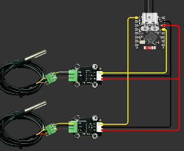
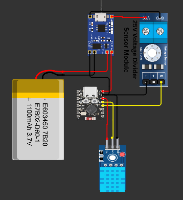

# ServerGuard IoT — Hardware & Embedded Firmware

**Ветка разработки аппаратной части (Hardware & Circuit Design)**  
**Разработчик:** Нгуен Зуй-Ань
**Команда проекта:** Нгуен Зуй-Ань (Hardware), Артаа Эртине (Backend), Золотухин Андрей (Frontend)

---

## О модуле Hardware

Аппаратный комплекс **ServerGuard IoT** — это энергонезависимый внешний сторож для серверных стоек без аппаратного интерфейса IPMI. Комплекс решает проблему «слепых» инцидентов (падение сервера, отключение фазы 220В, зависание сетевого шлюза или локальный перегрев внутри шкафа).

### Ключевые архитектурные принципы:
1. **Двухуровневая топология с «узким горлышком» (Choke Point):**
   - **Узел №1 (Локальный датчик стойки):** работает в закрытом радиоконтуре **ESP-NOW** без IP-адреса и без подключения к корпоративному Wi-Fi.
   - **Узел №2 (MAIN-шлюз / Глобальный контроллер помещения):** единственная точка выхода в сеть, оснащенная резервным `Li-Po` питанием, контролем 220В, датчиком климата зала (`DHT11`) и модулем «Тройного пинга».
2. **Принцип Single Source of Truth (Единый источник истины):**
   - Аппаратные узлы отвечают **строго за сбор и доставку «сырых» физических метрик** (`Data Plane`).
   - Все пороговые значения (`maxIn`, `maxOut`, `maxDelta`) и бизнес-правила триггеров хранятся и обрабатываются **исключительно на стороне Backend-сервера (`Control Plane`)**, что полностью исключает рассинхронизацию настроек между платой и БД.

---

## Спецификация компонентов

| № | Компонент | Кол-во | Назначение в схеме |
| :-: | :--- | :-: | :--- |
| 1 | **ESP32-C3 SuperMini (`ESP32C3FH4`, 4MB)** | 2 шт. | Микроконтроллеры Узла стойки (№1) и MAIN-шлюза (№2) |
| 2 | **Выносной термозонд `DS18B20` (с адаптером 1-Wire)** | 2 шт. | Замер температуры на **Входе (вдув)** и **Выходе (кулер сервера)** |
| 3 | **Модуль `DHT11` (`KY-015`, 3 пина)** | 1 шт. | Глобальный замер температуры и влажности в помещении серверной |
| 4 | **Датчик напряжения `0–25V DC` (делитель 1:5)** | 1 шт. | Безопасный контроль наличия сети 220В (через 5В адаптер до батареи) |
| 5 | **Модуль заряда и защиты `TP4056 Type-C`** | 1 шт. | Контроллер заряда резервного аккумулятора и бесперебойного питания |
| 6 | **Аккумулятор `Li-Po 3.7V` (`603450`, 1100 мАч)** | 1 шт. | Резервный буфер питания MAIN-шлюза при блэкауте (до 2–4 ч работы) |
| 7 | **Корпус РЭА (`75 × 50 × 25 мм`)** | 2 шт. | Защитные боксы на неодимовых магнитах (без сверления стоек) |

---

## Физическая схема подключения (Pinout)

### Main_server



### Temp_sens_PC



## Сетевой цикл, DHCP и JSON-контракты

### Этап 1. Первичная настройка (До подключения к роутеру)
1. **Связь Узел стойки $\leftrightarrow$ MAIN-шлюз:** работает поверх радиоканала **ESP-NOW** на уровне MAC-адресов (без участия роутера и DHCP). Узел стойки автоматически сканирует каналы `1..13` и привязывается к MAIN-шлюзу.
2. **Связь Смартфон $\leftrightarrow$ MAIN-шлюз:** при первом включении MAIN-шлюз поднимает точку доступа **`ServerGuard-Setup`** и собственный **DHCP-сервер** (IP платы: `192.168.4.1`). Пользователь с телефона передает плате `ssid`, `pass` и `backend_url`.

### Этап 2. Вход в сеть по DHCP роутера
При подключении к рабочему Wi-Fi роутеру MAIN-шлюз получает по протоколу **DHCP**:
* Свой локальный IP (`gateway_ip`),
* IP-адрес самого роутера (`WiFi.gatewayIP()`), который автоматически используется как первая точка проверки в «Тройном пинге».

---

### Этап 3. Команда привязки и синхронизации (`POST /api/sync`)
Сразу после получения IP по DHCP MAIN-шлюз отправляет на Backend-сервер стартовый пакет регистрации (без пороговых значений!):

**Запрос от MAIN-шлюза к Backend (`POST /api/sync`):**
```json
{
  "event": "gateway_sync",
  "gateway_mac": "34:85:18:A1:B2:C3",
  "gateway_ip": "192.168.1.45",
  "local_sensors": ["voltage_220v", "dht11_room_temp", "dht11_room_hum"],
  "discovered_nodes": [
    {
      "node_mac": "A0:B1:C2:D3:E4:F5",
      "sensors": ["ds18b20_in", "ds18b20_out"],
      "online": true
    }
  ]
}
```

**Ответ от Backend к MAIN-шлюзу (`200 OK`):**
```json
{
  "status": "synced",
  "config": {
    "send_interval_s": 10,
    "ping_target_ip": "192.168.1.50",
    "ping_internet_ip": "8.8.8.8"
  }
}
```

---

### Этап 4. Рабочая отправка телеметрии (`POST /api/telemetry`)
Отправляется планово каждые `send_interval_s` секунд (по умолчанию `10 сек`) ИЛИ **мгновенно вне очереди (за 100 мс)** при изменении статуса розетки `power_220v` (`emergency: true`):

```json
{
  "gateway_mac": "34:85:18:A1:B2:C3",
  "emergency": false,
  "power_220v": true,
  "room_temp": 21.5,
  "room_humidity": 42.0,
  "pings": {
    "router": true,
    "target_server": true,
    "internet": true
  },
  "nodes": [
    {
      "node_mac": "A0:B1:C2:D3:E4:F5",
      "online": true,
      "temp_in": 22.4,
      "temp_out": 35.1
    }
  ]
}
```
